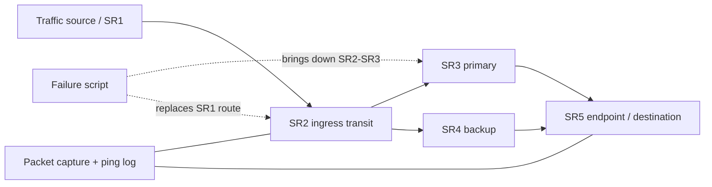

# Architecture and topology

## Addressing

| Link | Endpoint A | Endpoint B |
|---|---|---|
| SR1–SR2 | `2001:db8:12::1/64` | `2001:db8:12::2/64` |
| SR2–SR3 | `2001:db8:23::2/64` | `2001:db8:23::3/64` |
| SR3–SR5 | `2001:db8:35::3/64` | `2001:db8:35::5/64` |
| SR2–SR4 | `2001:db8:24::2/64` | `2001:db8:24::4/64` |
| SR4–SR5 | `2001:db8:45::4/64` | `2001:db8:45::5/64` |

## SIDs

- SR2 transit: `2001:db8:101::2` — End
- SR3 primary: `2001:db8:100::3` — End
- SR4 backup: `2001:db8:100::4` — End
- SR5 endpoint: `2001:db8:100::5` — End.DT6
- Destination: `2001:db8:ffff::5/128`, local in SR5 table 105

The route commands list segments in the order expected by Linux `iproute2`; validate the actual active destination using packet capture for your installed kernel/iproute2 version.
